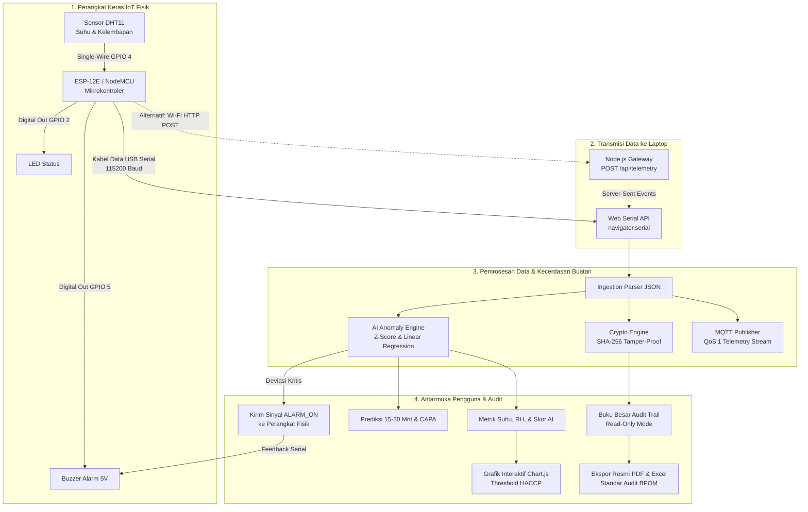

# Dokumen Alur Sistem & Arsitektur Teknis - PantauPangan

> **Sistem Pencatatan Log Otomatis Suhu dan Kelembapan Berbasis ESP-12E dan DHT11 untuk Audit Trail Digital HACCP pada Cold Chain Industri Pangan**

Dokumen ini menjelaskan secara menyeluruh arsitektur sistem, alur data (*end-to-end data pipeline*), skema perkabelan (*hardware wiring*), modul kecerdasan buatan (*AI Anomaly Detection*), serta mekanisme keamanan audit trail digital (*SHA-256 Hash Chain*) untuk pemenuhan regulasi **BPOM RI** dan standar **Codex Alimentarius HACCP CXC 1-1969**.

---

## 1. Diagram Alur Sistem (End-to-End Workflow)



---

## 2. Pemetaan Pin Perkabelan (Hardware Wiring Pinout)

Berikut adalah interkoneksi pin fisik antara mikrokontroler **ESP-12E (NodeMCU)** dengan komponen sensor dan aktuator:

| Nama Komponen | Pin Komponen | Pin ESP-12E | Tipe Sinyal | Fungsi Teknis |
| :--- | :--- | :--- | :--- | :--- |
| **Sensor DHT11** | DATA / OUT | **GPIO 4 (D2)** | Digital Input (1-Wire) | Membaca data periodik suhu (°C) dan kelembapan (% RH). |
| **Sensor DHT11** | VCC | **3.3V / 3V3** | Daya DC | Catu daya operasional modul sensor. |
| **Sensor DHT11** | GND | **GND** | Ground | Jalur referensi massa sirkuit. |
| **Buzzer Aktif 5V** | I / IN (+) | **GPIO 5 (D1)** | Digital Output | Alarm lokal berbunyi otomatis saat suhu melampaui batas kritis. |
| **Buzzer Aktif 5V** | GND (-) | **GND** | Ground | Massa buzzer. |
| **LED Indikator** | Anoda (+) | **GPIO 2 (D4)** | Digital Output | Hijau = Kondisi Normal; Merah = Terdeteksi Anomali. |
| **Kabel USB Micro** | Port USB | **USB Laptop** | Serial UART (TX/RX) | Penyuplai daya 5V sekaligus komunikasi data serial (115200 Baud). |

---

## 3. Format Data JSON Telemetri

Data yang dipancarkan oleh firmware [PantauPangan_ESP.ino](file:///c:/PantauPangan/firmware/PantauPangan_ESP.ino) dikemas dalam string JSON dengan interval 2.5 detik:

```json
{
  "device_id": "ESP-12E-CCP-01",
  "temperature": 4.15,
  "humidity": 84.2,
  "battery_v": 4.08,
  "alarm": false
}
```

Ketika diteruskan ke ingestion broker MQTT (*Teknologi Sistem Terintegrasi*), payload diperkaya dengan metadata pelacakan (*traceability*):

```json
{
  "device_id": "ESP-12E-CCP-01",
  "firmware": "v2.4.1-haccp",
  "zone": "chilled_room",
  "timestamp": "2026-10-30T09:45:00.000Z",
  "sensors": {
    "temp_c": 4.15,
    "humidity_pct": 84.2
  },
  "diagnostics": {
    "battery_voltage": 4.08,
    "battery_pct": 94,
    "alarm_active": false
  },
  "qos": 1
}
```

---

## 4. Mekanisme Kecerdasan Buatan (AI Engine)

Modul AI pada [js/ai-engine.js](file:///c:/PantauPangan/js/ai-engine.js) menjalankan 3 algoritma matematis secara paralel:

### 4.1. Deteksi Anomali Statistik (Z-Score)
Untuk setiap pembacaan baru $x$, dihitung deviasi terhadap jendela riwayat (*sliding window* $N=25$ titik):
$$\mu = \frac{1}{N} \sum_{i=1}^{N} x_i \quad , \quad \sigma = \sqrt{\frac{1}{N-1} \sum_{i=1}^{N} (x_i - \mu)^2}$$
$$Z = \frac{x - \mu}{\sigma}$$
* **$|Z| \le 2.2$:** Fluktuasi termal wajar (**Normal**).
* **$|Z| > 2.2$:** Perubahan mendadak di luar variasi alami ruangan (**Warning / Peringatan Anomali**).

### 4.2. Prediksi Laju Tren Suhu (*Predictive Temperature Drift*)
Menggunakan metode **Regresi Linier Sederhana** pada 10 data terakhir untuk menghitung gradien kemiringan ($m = \frac{\Delta T}{\Delta t}$):
$$m = \frac{k \sum (t \cdot T) - \sum t \sum T}{k \sum t^2 - (\sum t)^2}$$
* **Proyeksi Suhu 15 Menit ke Depan:**
  $$T_{forecast(15m)} = T_{saat\_ini} + (m \times 15)$$
* **Estimasi Waktu Menuju Batas Kritis (*Time-to-Breach*):**
  Jika suhu sedang naik ($m > 0$) dan masih di bawah batas atas $T_{max}$:
  $$t_{breach} = \frac{T_{max} - T_{saat\_ini}}{m} \quad (\text{menit})$$

### 4.3. Inferensi Akar Masalah (*Root Cause Engine*) & CAPA
1. **Pintu Cold Storage Terbuka:** Terdeteksi jika suhu melonjak cepat ($m > 0.15^\circ\text{C}/\text{m}$) disertai anjloknya kelembapan relatif ($\Delta RH < -10\%$) karena intrusi udara kering luar.
2. **Kegagalan Kompresor / Defrost Malfunction:** Terdeteksi jika suhu merangkak naik secara berkelanjutan ($T > T_{max}$) tanpa penurunan kelembapan drastis.
3. **Rekomendasi Tindakan Korektif (CAPA):** Memberikan instruksi operasional langsung (misal: penutupan seal magnetik pintu, karantina batch pangan *Hold & Quarantine*, atau pemindahan ke chiller cadangan).

---

## 5. Keamanan Data & Audit Trail Digital HACCP

Untuk memenuhi standar integritas audit **Badan POM** dan sertifikasi **ISO 22000**, data historis dirancang dengan prinsip:

1. **Read-Only Ledger:** Operator lapangan tidak memiliki izin (*permission*) untuk menyunting, menghapus, atau merevisi baris data historis.
2. **Cryptographic Hash Chain (SHA-256):** Setiap baris log disegel dengan hash kriptografi yang menyertakan hash dari entri sebelumnya:
   $$\text{Hash}_n = \text{SHA256}(\text{ID} \parallel \text{Timestamp} \parallel \text{Zona} \parallel \text{Suhu} \parallel \text{RH} \parallel \text{Status} \parallel \text{Hash}_{n-1})$$
3. **Deteksi Manipulasi Data (*Tamper-Evident*):** Jika satu angka suhu diubah secara manual di masa lalu, seluruh rantai hash setelahnya akan rusak. Tombol **"Verifikasi Hash"** pada dashboard memvalidasi keutuhan rantai log secara instan.

---

## 6. Standar Suhu Batas Kritis (Critical Control Point / CCP)

| Zona Fasilitas CCP | Standar Suhu Aman | Standar Kelembapan | Dampak Mutu Pangan |
| :--- | :--- | :--- | :--- |
| **Chilled Room** | **0.0°C s.d. 5.0°C** | **80.0% s.d. 90.0%** | Mencegah perkembangbiakan bakteri patogen *Listeria monocytogenes* & *Salmonella*. Suhu $>5^\circ\text{C}$ masuk zona bahaya (*Danger Zone*). |
| **Frozen Room** | **-18.0°C s.d. -25.0°C** | Bebas / Tidak Kritis | Menghentikan total aktivitas enzimatis dan kristalisasi cairan intraseluler bahan pangan beku. |
| **Dry Storage** | **20.0°C s.d. 30.0°C** | **< 75.0% RH** | Menjaga bahan kering (tepung, gula, rempah) dari penggumpalan (*caking*) dan jamur penghasil mikotoksin. |

---

## 7. Panduan Operasional Singkat

1. **Menjalankan Server Dashboard:**
   ```bash
   node server.js
   ```
   Akses via browser di: `http://localhost:3000/`.
2. **Menghubungkan Perangkat Fisik:**
   * Colokkan ESP-12E ke port USB laptop.
   * Klik tombol **"Sambungkan USB Perangkat"** pada bilah navigasi header.
   * Pilih COM Port perangkat yang terdeteksi (Web Serial API).
3. **Ekspor Berkas Audit Resmi:**
   * Klik **"Ekspor Laporan"** di pojok kanan atas.
   * Pilih format **PDF** untuk dokumen resmi bersertifikat BPOM lengkap dengan tanda tangan elektronik, atau **Excel (.xlsx)** untuk lembar kerja rekapitulasi data.
