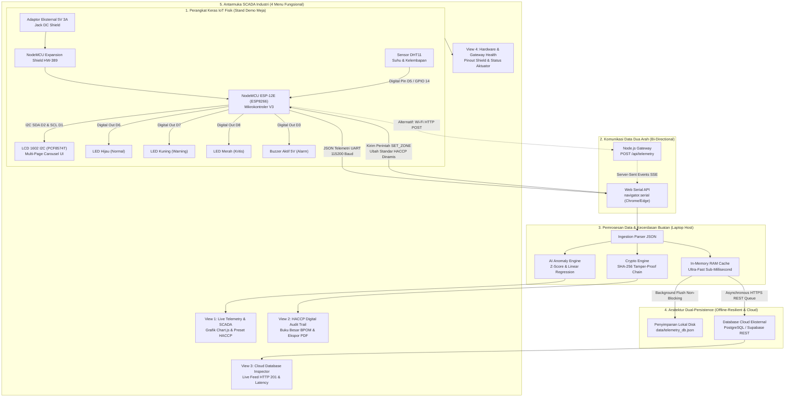

# 📐 Dokumen Alur Sistem & Arsitektur Teknis - PantauPangan

> **Sistem SCADA Monitoring Suhu dan Kelembapan Berbasis NodeMCU ESP-12E, Expansion Shield HW-389, dan LCD 1602 I2C untuk Audit Trail Digital HACCP pada Cold Chain Industri Pangan dengan Dukungan External Cloud Database**

Dokumen ini menjelaskan secara menyeluruh arsitektur sistem, alur transmisi data (*end-to-end data pipeline*), skema perkabelan (*hardware wiring pinout*), mekanisme animasi display LCD 1602, modul kecerdasan buatan (*AI Anomaly Detection*), arsitektur *Hybrid Dual-Persistence* ke Database Cloud eksternal, serta mekanisme keamanan *digital audit trail* (**SHA-256 Hash Chain**) untuk pemenuhan regulasi **BPOM RI** dan standar **Codex Alimentarius HACCP CXC 1-1969**.

---

## 1. Diagram Alur Sistem (End-to-End Workflow)



---

## 2. Pemetaan Pin Perkabelan (Hardware Wiring Pinout)

Berikut adalah interkoneksi pin fisik antara mikrokontroler **NodeMCU ESP-12E**, **Baseboard Expansion Shield (HW-389)**, dan modul sensor/aktuator:

| Nama Komponen | Pin Modul | Pin NodeMCU Shield | GPIO ESP8266 | Tipe Sinyal | Fungsi Teknis |
| :--- | :--- | :--- | :--- | :--- | :--- |
| **LCD 1602 I2C** | SDA | **Pin D2** | GPIO 4 | I2C Serial Data | Jalur data komunikasi LCD I2C (Alamat `0x27`). |
| **LCD 1602 I2C** | SCL | **Pin D1** | GPIO 5 | I2C Serial Clock | Jalur pulsa clock sinkronisasi transmisi I2C. |
| **LCD 1602 I2C** | VCC & GND | **5V & GND Shield** | - | Daya 5V DC | Menjamin lampu latar biru dan kontras teks tajam. |
| **Sensor DHT11** | DATA / Signal | **Pin D5** | GPIO 14 | Digital Input (1-Wire)| Pembacaan data suhu (°C) dan kelembapan (% RH). |
| **Sensor DHT11** | VCC & GND | **3V3/5V & GND** | - | Daya DC | Catu daya operasional modul sensor. |
| **LED Hijau** | Anoda (+) | **Pin D6** | GPIO 12 | Digital Output | Menyala saat kondisi lingkungan **NORMAL** (Aman). |
| **LED Kuning** | Anoda (+) | **Pin D7** | GPIO 13 | Digital Output | Menyala saat kondisi **WARNING** (Mendekati Batas). |
| **LED Merah** | Anoda (+) | **Pin D8** | GPIO 15 | Digital Output | Menyala saat kondisi **KRITIS / PELANGGARAN HACCP**. |
| **Buzzer Aktif 5V**| Positif (+) | **Pin D3** | GPIO 0 | Digital Output | Alarm lokal berbunyi otomatis saat deviasi kritis. |
| **Catu Daya Utama**| Jack DC Shield | **Adaptor 5V 3A** | - | Sumber Daya Utama | Memberikan suplai arus stabil ke seluruh modul. |

---

## 3. Sistem Tampilan Animasi LCD 1602 Non-Blocking

Firmware [`firmware/PantauPangan_ESP.ino`](file:///c:/PantauPangan/firmware/PantauPangan_ESP.ino) mengimplementasikan teknik animasi *non-blocking timer* berbasis `millis()`, mengganti tampilan setiap **3.2 detik**:

1. **Halaman 1 `[1]` (Telemetri Utama):**
   ```text
   T: 23.5 C  H: 52%
   Status: NORMAL
   ```
   *Menampilkan pembacaan sensor suhu dan kelembapan terkini serta ringkasan status kepatuhan.*

2. **Halaman 2 `[2]` (Analisis Deviasi HACCP):**
   ```text
   DEVIASI SUHU:
   Lebih: +18.5 C
   ```
   *Menampilkan selisih matematis deviasi suhu terhadap batas kritis atas atau bawah.*

3. **Halaman 3 `[3]` (Instruksi Darurat / CAPA Marquee Text):**
   ```text
   PENANGANAN CCP:
   TINDAKAN: Periksa Unit Pendingin...
   ```
   *Teks berjalan otomatis (*running text*) dengan kecepatan 300 ms/karakter yang memandu operator melakukan tindakan darurat saat terjadi deviasi kritis.*

---

## 4. Mekanisme Komunikasi Bi-Directional (Web Serial)

Sistem Web Serial API tidak hanya membaca data telemetri, tetapi juga dapat mengirimkan perintah kontrol balik ke mikrokontroler secara instan:
- **Format Telemetri dari ESP ke Laptop (Tiap 2.5 Detik):**
  ```json
  {
    "device_id": "ESP-12E-CCP-01",
    "temperature": 23.5,
    "humidity": 52.0,
    "status": "NORMAL",
    "alarm": false
  }
  ```
- **Format Perintah dari Dashboard ke ESP (Kendali Standar Suhu Dinamis):**
  ```text
  SET_ZONE:chilled_room,0.0,5.0
  ```
  *ESP menerima perintah ini melalui UART Serial, memperbarui variabel `limitMinTemp` dan `limitMaxTemp`, lalu mengevaluasi kondisi LED dan Buzzer seketika tanpa perlu restart.*

---

## 5. Mekanisme Kecerdasan Buatan (AI Engine)

Modul AI pada [js/ai-engine.js](file:///c:/PantauPangan/js/ai-engine.js) menjalankan algoritma statistik secara paralel:

### 5.1. Deteksi Anomali Statistik (Z-Score)
Untuk setiap pembacaan baru $x$, dihitung deviasi terhadap jendela riwayat (*sliding window* $N=25$ titik):
$$\mu = \frac{1}{N} \sum_{i=1}^{N} x_i \quad , \quad \sigma = \sqrt{\frac{1}{N-1} \sum_{i=1}^{N} (x_i - \mu)^2}$$
$$Z = \frac{x - \mu}{\sigma}$$
* **$|Z| \le 2.2$:** Fluktuasi termal wajar (**Normal**).
* **$|Z| > 2.2$:** Perubahan mendadak di luar variasi alami ruangan (**Peringatan Anomali**).

### 5.2. Prediksi Laju Tren Suhu (*Predictive Temperature Drift*)
Menggunakan metode **Regresi Linier Sederhana** pada 10 data terakhir untuk menghitung gradien kemiringan ($m = \frac{\Delta T}{\Delta t}$):
$$m = \frac{k \sum (t \cdot T) - \sum t \sum T}{k \sum t^2 - (\sum t)^2}$$
* **Proyeksi Suhu 15 Menit ke Depan:**
  $$T_{forecast(15m)} = T_{saat\_ini} + (m \times 15)$$
* **Estimasi Waktu Menuju Batas Kritis (*Time-to-Breach*):**
  $$t_{breach} = \frac{T_{max} - T_{saat\_ini}}{m} \quad (\text{menit})$$

---

## 6. Arsitektur Hybrid Dual-Persistence & Cloud Synchronization

Untuk menjamin keandalan saat pameran/expo, backend [`server.js`](file:///c:/PantauPangan/server.js) menggunakan arsitektur **Dual-Persistence**:

1. **Lapisan Primer (RAM In-Memory & Local Disk):**
   - Transaksi tersimpan di RAM dengan latensi `<0.01 ms`.
   - Data di-flush ke berkas `data/telemetry_db.json` dan `data/audit_db.json` setiap 10 detik secara non-blocking.
   - **Tahan Gangguan (Offline-Resilient):** Sistem tetap bekerja 100% normal tanpa error meskipun koneksi internet aula mati.

2. **Lapisan Sekunder (External Cloud Database REST):**
   - Data otomatis dikirimkan ke endpoint REST Cloud (PostgreSQL / Supabase REST).
   - Backend memantau status HTTP (`201 Created`), latency *round-trip* (~38-50 ms), dan jumlah baris tersimpan.
   - Tersedia modul **Cloud Database Inspector** di frontend untuk menampilkan log sinkronisasi cloud waktu-nyata dan tombol uji tulis langsung (*instant write test*).

---

## 7. Integritas Keamanan Audit Trail (SHA-256 Hash Chain)

Sesuai ketentuan audit BPOM RI dan prinsip **ALCOA+**, setiap baris log audit disegel menggunakan fungsi hash kriptografi **SHA-256**:

$$H_i = \text{SHA-256}(H_{i-1} \parallel \text{Timestamp} \parallel \text{DeviceID} \parallel T \parallel RH \parallel \text{Status})$$

Jika terdapat upaya modifikasi data historis pada basis data, rantai hash (*hash chain*) akan seketika terputus dan status integritas berubah menjadi **TAMPERED (Ilegal)**.
Dokumen resmi dapat diekspor langsung ke format **PDF Resmi BPOM** dan **Excel (.xlsx)** lengkap dengan stempel digital dan nama auditor.
