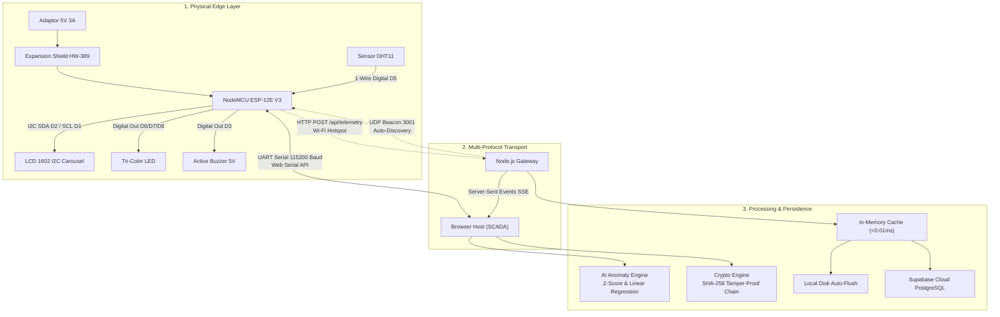

# 📋 NOTULENSI & LAPORAN ARSITEKTUR INTEGRASI MULTI-DISIPLIN
## Sistem PantauPangan: SCADA Cold Chain & Digital Audit Trail HACCP

> **Tanggal Terbit:** 16 November 2026  
> **Status Sistem:** *Verified Production-Ready Prototype*  
> **Target Mata Kuliah:** Teknologi Sistem Terintegrasi (TSI / TST) & Kecerdasan Buatan (AI)  

---

## 📌 Metadata Dokumen & Cakupan Disiplin Ilmu

| Komponen Metadata | Keterangan & Spesifikasi |
| :--- | :--- |
| **Mata Kuliah Utama 1** | **Teknologi Sistem Terintegrasi (TSI / TST)** |
| **Mata Kuliah Utama 2** | **Kecerdasan Buatan (Artificial Intelligence - AI)** |
| **Mata Kuliah Pendukung** | Internet of Things (IoT), Sistem Tertanam, Kriptografi Data, Cloud Computing, Manajemen Kualitas Pangan |
| **Regulasi Acuan** | Standar BPOM RI (CDOB/CPPOB) & Codex Alimentarius HACCP CXC 1-1969 |
| **Perangkat Keras Utama** | NodeMCU ESP-12E V3, Baseboard HW-389, Sensor DHT11, LCD 1602 I2C, Active Buzzer 5V, Tri-Color LED |
| **Perangkat Lunak Utama** | Node.js Core Backend, Web Serial API, Chart.js, jsPDF, SheetJS XLSX, Supabase Cloud PostgreSQL |

---

## 1. Integrasi Mata Kuliah: Teknologi Sistem Terintegrasi (TSI / TST)

Mata kuliah **Teknologi Sistem Terintegrasi** berfokus pada penggabungan subsistem elektronika, protokol jaringan, pemrosesan data, dan antarmuka kontrol menjadi satu kesatuan fungsional yang andal (*interoperable*).

### 1.1. Integrasi 7 Protokol Komunikasi Data
1. **I2C Bus (Alamat `0x27`):** Menggunakan jalur Serial Data (SDA Pin D2 / GPIO 4) dan Serial Clock (SCL Pin D1 / GPIO 5) untuk menggerakkan LCD 1602 via backpack PCF8574T.
2. **1-Wire Digital Protocol:** Membaca pulsa data mikrodetik dari sensor DHT11 pada Pin D5 (GPIO 14).
3. **UART Serial (115200 Baud):** Komunikasi langsung kabel USB dengan browser laptop menggunakan **Web Serial API** (`navigator.serial`).
4. **UDP Beacon Broadcast (Port 3001):** Layanan *Auto-Discovery* jaringan nirkabel—laptop memancarkan beacon broadcast subnet sehingga ESP mendeteksi IP server secara otomatis tanpa hardcoding.
5. **HTTP REST (Port 3000):** Pengiriman berkala JSON telemetri via `POST /api/telemetry` dan pertukaran status melalui `POST /api/esp/command`.
6. **Server-Sent Events (SSE):** Streaming asinkron satu arah dari backend ke browser SCADA melalui endpoint `/api/events` tanpa overhead polling.
7. **HTTPS REST Cloud:** Sinkronisasi asinkron data telemetri ke cloud eksternal Supabase PostgreSQL.

### 1.2. Kontrol Tertutup Dua Arah (Bi-Directional Closed-Loop Control)
* **Pengubahan Standar HACCP Dinamis:** Operator dapat mengganti ruang aktif di dashboard (Cold Storage 0–5°C, Ruang Ambient 18–32°C, Deep Freezer -22 s/d -18°C). Dashboard mengirimkan instruksi `SET_ZONE:chilled_room,0.0,5.0` yang langsung mengubah nilai batas kritis pada mikrokontroler.
* **Remote Buzzer Mute:** Operator dapat mematikan suara buzzer fisik dari web (`MUTE_BUZZER`), langsung memutus logika output Pin D3.
* **Respon Instan (< 10 ms):** Logika aktuator di-trigger seketika via fungsi `updateActuators()` saat instruksi diterima tanpa menunggu jeda polling sensor 2.0 detik.

### 1.3. Redundansi & Ketahanan Offline (Offline Resilience)
* **Hybrid Dual-Mode Communication:** Jika jaringan Wi-Fi bermasalah, transmisi dialihkan otomatis ke kabel USB Serial (`USB Live COM`), dan sebaliknya jika kabel dilepas maka sistem otomatis beralih ke Wi-Fi.
* **Dual-Persistence:** Data disimpan ke RAM In-Memory Cache (latensi `<0.01 ms`), di-flush ke disk lokal (`telemetry_db.json`) setiap 10 detik, dan diunggah ke cloud secara non-blocking. Jika koneksi internet aula/lab mati total, sistem tetap beroperasi normal 100%.

---

## 2. Integrasi Mata Kuliah: Kecerdasan Buatan (Artificial Intelligence - AI)

Kecerdasan Buatan pada sistem ini bertindak sebagai mesin inferensi cerdas (*application-level intelligence*) untuk mendeteksi anomali mikroklimat, meramalkan tren kenaikan suhu, dan memberikan diagnosis akar masalah:

### 2.1. Deteksi Anomali Statistik (Dynamic Z-Score)
Sistem menerapkan evaluasi statistik dinamis berbasis jendela geser (*sliding window* $N = 25$ titik sampel):

$$\mu = \frac{1}{N} \sum_{i=1}^{N} x_i \quad , \quad \sigma = \sqrt{\frac{1}{N-1} \sum_{i=1}^{N} (x_i - \mu)^2} \quad , \quad Z = \frac{x - \mu}{\sigma}$$

* **$|Z| \le 2.2$:** Kondisi Termal Stabil (**NORMAL**).
* **$|Z| > 2.2$:** Peringatan Anomali Termal (**WARNING**)—mendeteksi fluktuasi mendadak di luar pola mikroklimat wajar ruangan meskipun batas kritis absolut belum tertembus.

### 2.2. Prediksi Laju Tren Suhu & Estimasi Pelanggaran Kritis
Menggunakan metode **Regresi Linier Sederhana (Least Squares Linear Regression)** pada 10 titik data sampling terakhir untuk menghitung gradien laju perubahan suhu ($m = \frac{\Delta T}{\Delta t}$ dalam °C/menit):

$$m = \frac{k \sum(t \cdot T) - \sum t \sum T}{k \sum t^2 - (\sum t)^2}$$

* **Proyeksi Suhu 15 Menit ke Depan (Forecast $T+15$):**
  $$T_{\text{forecast}} = T_{\text{saat\_ini}} + (m \times 15)$$
* **Countdown Menuju Batas Kritis (*Time-to-Breach Estimation*):**
  $$t_{\text{breach}} = \frac{T_{\text{max}} - T_{\text{saat\_ini}}}{m} \quad (\text{menit})$$
  *Memberikan alarm peringatan dini sebelum makanan membusuk.*

### 2.3. Sistem Pakar & Inferensi Diagnostik Akar Masalah (Root Cause Diagnosis)
Menganalisis korelasi multivariat Suhu ($T$) vs Kelembapan Relatif ($RH$):

| Korelasi Parameter | Diagnosis AI Akar Masalah | Rekomendasi Tindakan CAPA Otomatis |
| :--- | :--- | :--- |
| **Suhu Naik Cepat ($m > 0.15$) & RH Anjlok ($< 70\%$)** | **Infiltrasi Udara Luar (Pintu Terbuka)** | Periksa fisik pintu, rapatkan magnetic seal strip, batasi akses keluar-masuk logistik. |
| **Suhu Naik Melebihi Batas ($T > 5^\circ\text{C}$) & RH Stabil** | **Kegagalan Kompresor / Evaporator** | Isolasi batch produk pangan (*Hold & Quarantine*), alihkan ke cold storage cadangan. |
| **Skor $|Z| > 2.0$ namun Suhu masih dalam batas** | **Fluktuasi Mikroklimat (Thermal Drift)** | Amati tren 5 menit ke depan, pastikan sirkulasi kipas pendingin tidak terhalang boks palet. |
| **Suhu & RH dalam rentang ideal** | **Kondisi Termal Terkendali** | Sistem stabil dalam rentang aman HACCP. Lanjutkan pemantauan rutin. |

---

## 3. Integrasi Mata Kuliah Pendukung Terkait

### 3.1. Internet of Things (IoT) & Embedded Systems
* NodeMCU ESP-12E V3 dikombinasikan dengan Expansion Baseboard HW-389 yang disuplai adaptor eksternal 5V 3A untuk menjaga kestabilan tegangan.
* Carousel multi-halaman non-blocking pada LCD 1602 I2C menggunakan pewaktu `millis()` berganti tiap 3.2 detik (Halaman 0: Telemetri, Halaman 1: Analisis Deviasi, Halaman 2: Tindakan CAPA Marquee Text berjalan 300 ms/karakter).

### 3.2. Keamanan Informasi & Kriptografi (Cybersecurity)
* **Immutable SHA-256 Hash Chain:** Setiap log telemetri disegel dengan fungsi kriptografi berantai:
  $$H_i = \text{SHA-256}(H_{i-1} \parallel \text{Timestamp} \parallel \text{DeviceID} \parallel T \parallel RH \parallel \text{Status})$$
* Memenuhi prinsip **ALCOA+** (*Attributable, Legible, Contemporaneous, Original, Accurate*) dan standar integritas rekaman elektronik **FDA 21 CFR Part 11 & BPOM RI**. Jika ada manipulasi data di database, hash chain seketika rusak (*tamper detection*).

### 3.3. Rekayasa Basis Data & Cloud Computing
* Integrasi RESTful API ke Supabase Cloud PostgreSQL dengan offline buffer protection.
* Fitur Cloud Database Inspector untuk memantau status HTTP 201 Created dan latensi sinkronisasi (~38 ms).
* Ekspor dokumen audit resmi: PDF Resmi BPOM bersertifikasi digital (jsPDF) dan lembar kerja Excel (SheetJS XLSX).

### 3.4. Manajemen Mutu & Regulasi Pangan (HACCP)
* Mengacu pada **Codex Alimentarius (HACCP CXC 1-1969)** Prinsip 2 (Batas Kritis CCP) dan Prinsip 4 (Sistem Pemantauan).
* Menjaga komoditas pangan segar pada Cold Storage (0.0°C – 5.0°C) guna mencegah perkembangbiakan bakteri patogen *Listeria monocytogenes* dan *Salmonella*.

---

## 4. Matriks Validasi Skenario Pengujian

| Skenario Pengujian | Mata Kuliah Terkait | Parameter Uji | Hasil Verifikasi Sistem |
| :--- | :--- | :--- | :--- |
| **Uji Deviasi Kritis Cold Storage** | TSI, IoT, HACCP | Suhu sensor meja (~28°C) pada batas Cold Storage (0–5°C). | LED Merah menyala, Buzzer aktif seketika (<10 ms), status KRITIS. |
| **Uji Kontrol Tertutup Ubah Ruang** | TSI | Mengubah preset ke Ruang Ambient (18–32°C) via web. | ESP seketika beralih ke LED Hijau (Aman), Buzzer otomatis padam. |
| **Uji Prediksi Drift & Deteksi Anomali** | AI Engine | Kenaikan suhu konstan dianalisis via regresi linier & Z-Score. | AI menghitung laju slope (°C/menit), proyeksi T+15, dan time-to-breach. |
| **Uji Ketahanan Putus Jaringan** | TSI & Cloud DB | Internet laptop diputus saat demo berlangsung. | Sistem tetap berjalan 100% normal, data ter-buffer di RAM dan disk lokal. |
| **Uji Integritas Digital Audit Trail** | Kriptografi | Pembentukan buku besar SHA-256 berantai. | Dokumen resmi PDF BPOM dan Excel berhasil diekspor berstempel hash. |
