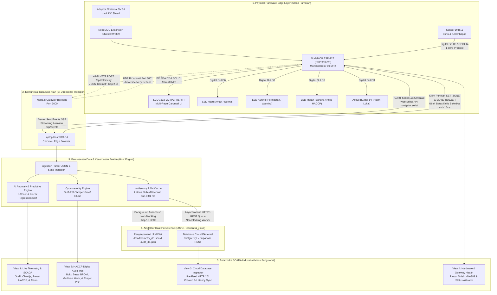

# 📋 DOKUMEN ARSITEKTUR SISTEM & NOTULENSI INTEGRASI MULTI-DISIPLIN
## Sistem PantauPangan: SCADA Cold Chain & Digital Audit Trail HACCP

> **Tanggal Terbit:** 16 November 2026  
> **Status Sistem:** *Verified Production-Ready Prototype*  
> **Target Mata Kuliah:** Teknologi Sistem Terintegrasi (TSI / TST) & Kecerdasan Buatan (Artificial Intelligence - AI)  
> **Sistem Operasi / Target:** NodeMCU ESP-12E (ESP8266 V3), Baseboard HW-389, Web SCADA (Node.js & Vanilla JS), Supabase Cloud

---

## 📌 Metadata Dokumen & Cakupan Disiplin Ilmu

| Komponen Metadata | Keterangan & Spesifikasi Ilmiah / Teknis |
| :--- | :--- |
| **Mata Kuliah Utama 1** | **Teknologi Sistem Terintegrasi (TSI / TST)** - Integrasi multi-protokol (I2C, 1-Wire, UART, UDP, HTTP, SSE, HTTPS Cloud), *Bi-directional Closed-Loop Control*, *Failover Redundancy*, & *Dual-Persistence*. |
| **Mata Kuliah Utama 2** | **Kecerdasan Buatan (Artificial Intelligence - AI)** - Deteksi Anomali Statistik Dinamis (*Sliding-Window Z-Score*), Prediksi Tren Kenaikan Suhu (*Least Squares Linear Regression*), Estimasi *Time-to-Breach*, dan *Rule-Based Expert System Root Cause Diagnosis*. |
| **Mata Kuliah Pendukung** | **Internet of Things (IoT) & Embedded Systems**, **Keamanan Informasi & Kriptografi Data**, **Rekayasa Basis Data & Cloud Computing**, serta **Manajemen Mutu & Regulasi Pangan (HACCP)**. |
| **Regulasi & Standar Acuan**| **BPOM RI** (Standar CDOB/CPPOB), **Codex Alimentarius HACCP CXC 1-1969**, dan **FDA 21 CFR Part 11 / Prinsip ALCOA+**. |
| **Perangkat Keras (Hardware)**| NodeMCU ESP-12E (ESP8266), Expansion Shield Baseboard HW-389, Sensor DHT11, LCD 1602 I2C (PCF8574T), Active Buzzer 5V, Tri-Color LED (Merah, Kuning, Hijau), Adaptor 5V 3A Jack DC. |
| **Perangkat Lunak (Software)**| Node.js Core Backend, Web Serial API (`navigator.serial`), Chart.js, jsPDF, SheetJS XLSX, Supabase External Cloud PostgreSQL REST. |

---

## 1. Diagram Alur Sistem Terintegrasi (End-to-End Workflow)

Berikut adalah diagram alur menyeluruh mulai dari akuisisi sensor fisik pada edge layer, transmisi multi-protokol, pemrosesan analitik kecerdasan buatan, persistensi ganda (RAM & Cloud), hingga visualisasi dashboard SCADA industri:



---

## 2. Pemetaan Pin Perkabelan Fisik (Hardware Wiring Pinout)

Berikut adalah interkoneksi pin fisik antara mikrokontroler **NodeMCU ESP-12E**, **Baseboard Expansion Shield (HW-389)**, dan modul sensor/aktuator:

| Nama Komponen | Pin Modul | Pin NodeMCU Shield | GPIO ESP8266 | Tipe Sinyal | Fungsi Teknis & Perilaku Logika |
| :--- | :--- | :--- | :--- | :--- | :--- |
| **LCD 1602 I2C** | SDA | **Pin D2** | GPIO 4 | I2C Serial Data | Jalur data komunikasi LCD I2C (Alamat `0x27`). |
| **LCD 1602 I2C** | SCL | **Pin D1** | GPIO 5 | I2C Serial Clock | Jalur pulsa clock sinkronisasi transmisi data I2C. |
| **LCD 1602 I2C** | VCC & GND | **5V & GND Shield** | - | Daya 5V DC | Menjamin lampu latar biru dan kontras karakter tajam. |
| **Sensor DHT11** | DATA / Signal | **Pin D5** | GPIO 14 | Digital Input (1-Wire)| Pembacaan data suhu (°C) dan kelembapan (% RH). |
| **Sensor DHT11** | VCC & GND | **3V3/5V & GND** | - | Daya DC | Catu daya operasional modul sensor mikroklimat. |
| **LED Hijau** | Anoda (+) | **Pin D6** | GPIO 12 | Digital Output | Menyala saat kondisi lingkungan **NORMAL / AMAN**. |
| **LED Kuning** | Anoda (+) | **Pin D7** | GPIO 13 | Digital Output | Menyala saat kondisi **WARNING** (Mendekati Batas Kritis). |
| **LED Merah** | Anoda (+) | **Pin D8** | GPIO 15 | Digital Output | Menyala saat kondisi **KRITIS / PELANGGARAN HACCP**. |
| **Buzzer Aktif 5V**| Positif (+) | **Pin D3** | GPIO 0 | Digital Output | Alarm lokal berbunyi otomatis saat deviasi kritis suhu. |
| **Catu Daya Utama**| Jack DC Shield | **Adaptor 5V 3A** | - | Daya Utama | Suplai arus mandiri tanpa membebani port USB laptop. |

---

## 3. Sistem Tampilan Animasi LCD 1602 Non-Blocking

Firmware [`firmware/PantauPangan_ESP.ino`](file:///c:/PantauPangan/firmware/PantauPangan_ESP.ino) mengimplementasikan teknik animasi antarmuka *non-blocking timer* berbasis `millis()` tanpa fungsi `delay()`, sehingga pembacaan sensor dan komunikasi serial tetap berjalan real-time. Tampilan berganti secara otomatis setiap **3.2 detik**:

1. **Halaman 1 `[1]` (Telemetri Utama):**
   ```text
   T: 23.5 C  H: 52%
   Status: NORMAL
   ```
   *Menampilkan pembacaan sensor suhu dan kelembapan terkini serta ringkasan status kepatuhan.*

2. **Halaman 2 `[2]` (Analisis Deviasi HACCP):**
   ```text
   DEVIASI SUHU:
   Lebih: +18.5 C
   ```
   *Menampilkan selisih matematis deviasi suhu terhadap batas kritis atas atau batas kritis bawah.*

3. **Halaman 3 `[3]` (Instruksi Darurat / Tindakan CAPA Marquee Running Text):**
   ```text
   PENANGANAN CCP:
   TINDAKAN: Periksa Unit Pendingin...
   ```
   *Teks berjalan otomatis (*marquee running text*) dengan kecepatan pergeseran 300 ms/karakter yang memandu operator melakukan tindakan darurat (Corrective Action) saat terjadi deviasi kritis.*

---

## 4. Integrasi Mata Kuliah: Teknologi Sistem Terintegrasi (TSI / TST)

Mata kuliah **Teknologi Sistem Terintegrasi** berfokus pada penggabungan subsistem elektronika, protokol jaringan, pemrosesan data, dan antarmuka kontrol menjadi satu kesatuan fungsional yang andal (*interoperable*).

### 4.1. Integrasi 7 Protokol Komunikasi Data
Sistem PantauPangan menggabungkan 7 protokol komunikasi data heterogen:

| No | Protokol Komunikasi | Lapisan Arsitektur | Media / Endpoint | Peran & Implementasi Fungsional |
| :--- | :--- | :--- | :--- | :--- |
| 1 | **I2C Bus Protocol** | Hardware Edge | Pin D1 (SCL) & D2 (SDA), `0x27` | Mengirim perintah byte ke modul LCD 1602 via IC expander PCF8574T. |
| 2 | **1-Wire Digital** | Hardware Edge | Pin D5 (GPIO 14) | Akuisisi sinyal digital pulsa waktu mikrodetik dari sensor DHT11. |
| 3 | **UART Serial (115200)** | Transport Edge-to-Host | Port USB COM (`navigator.serial`) | Transmisi telemetri dua arah kabel berkecepatan tinggi antara ESP dan Web Browser. |
| 4 | **UDP Broadcast (Port 3001)**| Network Transport | `255.255.255.255:3001` | *Auto-Discovery Beacon* - ESP menemukan alamat IP Gateway secara dinamis tanpa hardcode. |
| 5 | **HTTP REST (Port 3000)** | Network Transport | `POST /api/telemetry` & `/api/esp/command` | Transmisi telemetri via jaringan Wi-Fi LAN / Hotspot saat mode wireless aktif. |
| 6 | **Server-Sent Events (SSE)** | Application Transport | `GET /api/events` | *Real-time uni-directional push* dari backend Node.js ke antarmuka SCADA web. |
| 7 | **HTTPS REST Cloud** | Cloud Transport | Supabase RESTful API | Sinkronisasi data ke cloud database eksternal untuk pemantauan terpusat. |

### 4.2. Kontrol Tertutup Dua Arah (Bi-Directional Closed-Loop Control)
* **Pengubahan Standar HACCP Dinamis:** Operator dapat mengganti ruang aktif di dashboard (Cold Storage 0–5°C, Ruang Ambient 18–32°C, Deep Freezer -22 s/d -18°C). Dashboard mengirimkan instruksi serial:
  ```text
  SET_ZONE:chilled_room,0.0,5.0
  ```
  ESP menerima perintah ini melalui UART Serial, memperbarui variabel `limitMinTemp` dan `limitMaxTemp`, lalu mengevaluasi kondisi LED dan Buzzer seketika tanpa perlu restart.
* **Remote Buzzer Mute:** Operator dapat mematikan suara buzzer fisik dari tombol dashboard web (`MUTE_BUZZER`), langsung memutus logika output Pin D3.
* **Respon Instan (< 10 ms):** Logika aktuator di-trigger seketika via fungsi `updateActuators()` saat instruksi diterima tanpa menunggu jeda pembacaan sensor 2.0 detik.

### 4.3. Format Paket Data Serial & Telemetri JSON
- **Format Telemetri dari ESP ke Host Laptop (Tiap 2.0 Detik):**
  ```json
  {
    "device_id": "ESP-12E-CCP-01",
    "temperature": 23.5,
    "humidity": 52.0,
    "status": "NORMAL",
    "alarm": false
  }
  ```
- **Format Perintah Kontrol dari Host ke ESP:**
  ```text
  SET_ZONE:chilled_room,0.0,5.0
  MUTE_BUZZER
  ```

### 4.4. Redundansi & Ketahanan Offline (Offline Resilience)
* **Hybrid Dual-Mode Communication:** Jika jaringan Wi-Fi bermasalah, transmisi dialihkan otomatis ke kabel USB Serial (`USB Live COM`), dan sebaliknya jika kabel dilepas maka sistem otomatis beralih ke Wi-Fi.
* **Dual-Persistence:** Data disimpan ke RAM In-Memory Cache (latensi `<0.01 ms`), di-flush ke disk lokal (`telemetry_db.json`) setiap 10 detik, dan diunggah ke cloud secara non-blocking. Jika koneksi internet aula/lab mati total, sistem tetap beroperasi normal 100%.

---

## 5. Integrasi Mata Kuliah: Kecerdasan Buatan (Artificial Intelligence - AI)

Kecerdasan Buatan pada sistem ini bertindak sebagai mesin inferensi cerdas (*application-level intelligence*) pada [js/ai-engine.js](file:///c:/PantauPangan/js/ai-engine.js) untuk mendeteksi anomali mikroklimat, meramalkan tren kenaikan suhu, dan memberikan diagnosis akar masalah:

### 5.1. Deteksi Anomali Statistik (Dynamic Z-Score)
Sistem menerapkan evaluasi statistik dinamis berbasis jendela geser (*sliding window* $N = 25$ titik sampel) untuk menghitung rata-rata ($\mu$) dan standar deviasi ($\sigma$):

$$\mu = \frac{1}{N} \sum_{i=1}^{N} x_i \quad , \quad \sigma = \sqrt{\frac{1}{N-1} \sum_{i=1}^{N} (x_i - \mu)^2} \quad , \quad Z = \frac{x - \mu}{\sigma}$$

* **$|Z| \le 2.2$:** Kondisi Termal Stabil (**NORMAL**).
* **$|Z| > 2.2$:** Peringatan Anomali Termal (**WARNING**) - mendeteksi lonjakan atau penurunan drastis di luar pola mikroklimat wajar ruangan meskipun batas kritis absolut belum tertembus.

### 5.2. Prediksi Laju Tren Suhu & Estimasi Pelanggaran Kritis
Menggunakan metode **Regresi Linier Sederhana (Least Squares Linear Regression)** pada 10 titik data sampling terakhir untuk menghitung gradien laju perubahan suhu ($m = \frac{\Delta T}{\Delta t}$ dalam °C/menit):

$$m = \frac{k \sum(t \cdot T) - \sum t \sum T}{k \sum t^2 - (\sum t)^2}$$

* **Proyeksi Suhu 15 Menit ke Depan (Forecast $T+15$):**
  $$T_{\text{forecast}} = T_{\text{saat\_ini}} + (m \times 15)$$
* **Countdown Menuju Batas Kritis (*Time-to-Breach Estimation*):**
  $$t_{\text{breach}} = \frac{T_{\text{max}} - T_{\text{saat\_ini}}}{m} \quad (\text{menit})$$
  *Memberikan alarm peringatan dini sebelum produk pangan membusuk atau mengalami kerusakan termal.*

### 5.3. Sistem Pakar & Inferensi Diagnostik Akar Masalah (Root Cause Diagnosis)
Menganalisis korelasi multivariat Suhu ($T$) vs Kelembapan Relatif ($RH$):

| Korelasi Parameter | Diagnosis AI Akar Masalah | Rekomendasi Tindakan Korektif (CAPA) Otomatis |
| :--- | :--- | :--- |
| **Suhu Naik Cepat ($m > 0.15$) & RH Anjlok ($< 70\%$)** | **Infiltrasi Udara Luar (Pintu Terbuka)** | Periksa fisik pintu cold room, rapatkan magnetic seal strip, batasi akses keluar-masuk logistik. |
| **Suhu Naik Melebihi Batas ($T > 5^\circ\text{C}$) & RH Stabil** | **Kegagalan Kompresor / Evaporator** | Isolasi batch produk pangan (*Hold & Quarantine*), alihkan segera ke cold storage cadangan. |
| **Skor $|Z| > 2.0$ namun Suhu masih dalam batas** | **Fluktuasi Mikroklimat (Thermal Drift)** | Amati tren 5 menit ke depan, pastikan sirkulasi kipas pendingin tidak terhalang susunan boks palet. |
| **Suhu & RH dalam rentang ideal** | **Kondisi Termal Terkendali** | Sistem stabil dalam rentang aman HACCP. Lanjutkan pemantauan rutin. |

---

## 6. Integrasi Mata Kuliah Pendukung Terkait

### 6.1. Internet of Things (IoT) & Embedded Systems
* NodeMCU ESP-12E V3 dikombinasikan dengan Expansion Baseboard HW-389 yang disuplai adaptor eksternal 5V 3A untuk menjaga kestabilan tegangan modul aktuator dan I2C.
* Carousel multi-halaman non-blocking pada LCD 1602 I2C menggunakan pewaktu `millis()` berganti tiap 3.2 detik (Halaman 0: Telemetri, Halaman 1: Analisis Deviasi, Halaman 2: Tindakan CAPA Marquee Text berjalan 300 ms/karakter).

### 6.2. Keamanan Informasi & Kriptografi Data (Cybersecurity)
* **Immutable SHA-256 Hash Chain:** Setiap log telemetri dan audit disegel dengan fungsi kriptografi berantai:
  $$H_i = \text{SHA-256}(H_{i-1} \parallel \text{Timestamp} \parallel \text{DeviceID} \parallel T \parallel RH \parallel \text{Status})$$
* Memenuhi prinsip **ALCOA+** (*Attributable, Legible, Contemporaneous, Original, Accurate*) dan standar integritas rekaman elektronik **FDA 21 CFR Part 11 & BPOM RI**. Jika ada manipulasi data di database, hash chain seketika rusak (*tamper detection*).

### 6.3. Rekayasa Basis Data & Cloud Computing
* Arsitektur **Dual-Persistence**: Lapisan RAM in-memory cache dengan latensi `<0.01 ms` untuk respon seketika, background disk flush ke `data/telemetry_db.json`, dan integrasi HTTPS RESTful API ke Supabase Cloud PostgreSQL dengan offline buffer queue.
* Fitur **Cloud Database Inspector** di web SCADA untuk memantau status HTTP 201 Created dan latensi sinkronisasi (~38 ms).
* Ekspor dokumen audit resmi: PDF Resmi BPOM bersertifikasi digital (jsPDF) dan lembar kerja Excel (SheetJS XLSX).

### 6.4. Manajemen Mutu & Regulasi Pangan (HACCP)
* Mengacu pada **Codex Alimentarius (HACCP CXC 1-1969)** Prinsip 2 (Penetapan Batas Kritis CCP) dan Prinsip 4 (Sistem Pemantauan CCP).
* Menjaga komoditas pangan segar pada Cold Storage (0.0°C – 5.0°C) guna mencegah perkembangbiakan bakteri patogen *Listeria monocytogenes* dan *Salmonella*.

---

## 7. Matriks Validasi Skenario Pengujian Sistem

| Skenario Pengujian | Mata Kuliah Terkait | Parameter Uji | Hasil Verifikasi Sistem |
| :--- | :--- | :--- | :--- |
| **Uji Deviasi Kritis Cold Storage** | TSI, IoT, HACCP | Suhu sensor meja (~28°C) pada batas Cold Storage (0–5°C). | LED Merah menyala, Buzzer aktif seketika (<10 ms), status KRITIS. |
| **Uji Kontrol Tertutup Ubah Ruang** | TSI | Mengubah preset ke Ruang Ambient (18–32°C) via web. | ESP seketika beralih ke LED Hijau (Aman), Buzzer otomatis padam. |
| **Uji Prediksi Drift & Deteksi Anomali** | AI Engine | Kenaikan suhu konstan dianalisis via regresi linier & Z-Score. | AI menghitung laju slope (°C/menit), proyeksi T+15, dan time-to-breach. |
| **Uji Ketahanan Putus Jaringan** | TSI & Cloud DB | Internet laptop diputus saat demo berlangsung. | Sistem tetap berjalan 100% normal, data ter-buffer di RAM dan disk lokal. |
| **Uji Integritas Digital Audit Trail** | Kriptografi | Pembentukan buku besar SHA-256 berantai. | Dokumen resmi PDF BPOM dan Excel berhasil diekspor berstempel hash chain valid. |
| **Uji Tampilan Carousel LCD 1602** | IoT & Embedded | Pergantian halaman tiap 3.2 detik & Marquee CAPA 300 ms. | Halaman berganti mulus tanpa lag dan tanpa mengganggu pembacaan sensor. |
